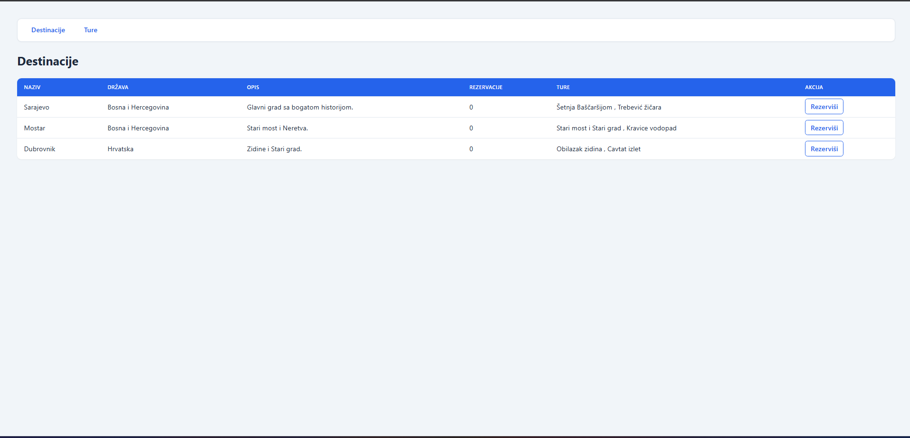
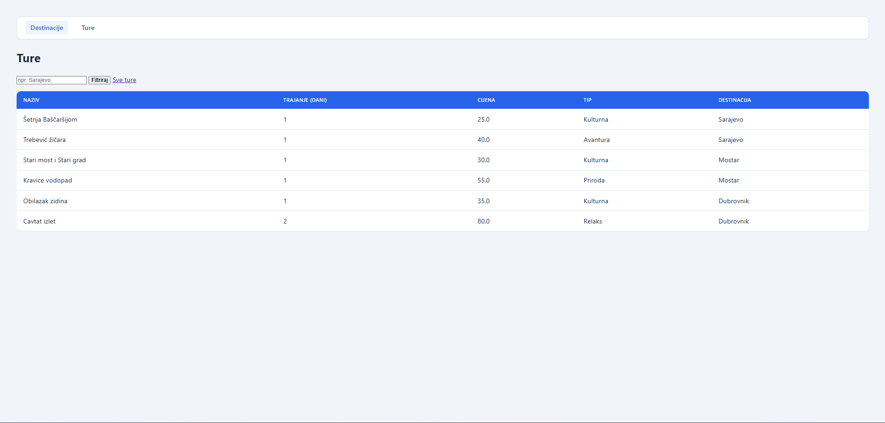

# Turizam

Mini MVC Spring Boot aplikacija (Lab 1 — Web programiranje).  
Tema: **Destination & Tour**. Aplikacija radi bez baze, sa in-memory podacima.

## Članovi tima

| Član | Doprinos |
|---|---|
| **Emir** | Startup projekta, MVC funkcionalnost, endpointi, data sloj (`DemoData`) |
| **Ahmed** | Stilizacija frontenda (Thymeleaf stranice) |
| **Emin** | Search / filter tura po destinaciji (`GET /b?destinacija=`) |

## Modeli i relacija

**Relacija: 1:N** — jedna destinacija ima više tura.

### Destination (Model A)

- `id`
- `name`
- `country`
- `description`
- `bookings` — brojač rezervacija (akcija)
- `tours` — lista tura te destinacije

### Tour (Model B)

- `id`
- `name`
- `durationDays`
- `price`
- `type`
- `destinationName` — ime destinacije (prikaz relacije na listi tura)

Primjer: destinacija Sarajevo ima ture *Šetnja Baščaršijom* i *Trebević žičara*.

## Data sloj

Klasa `DemoData` drži podatke u memoriji (nema baze).

- 3 destinacije: Sarajevo, Mostar, Dubrovnik
- 6 tura povezanih na destinacije
- `getDestinations()`, `getTours()`, `findDestinationById(id)`
- `findToursByDestination(name)` — pretraga tura (Emin)

## Endpointi

| Ruta | Opis |
|---|---|
| `GET /` | Redirect na `/a` |
| `GET /a` | Lista destinacija (`listA.html`) |
| `GET /b` | Lista tura (`listB.html`) |
| `GET /b?destinacija=Sarajevo` | Filtrirane ture po destinaciji |
| `GET /a/action/{id}` | Rezervacija destinacije (`bookings++`) i prikaz `action.html` |

Stranice: `listA.html`, `listB.html`, `action.html`.

## Pokretanje

Potrebno: **Java 21**, Maven Wrapper je u projektu.

IntelliJ: otvoriti ovaj folder (onaj sa `pom.xml`) kao Maven projekat, Run na `DemoApplication`.

Terminal (Windows PowerShell):

```powershell
.\mvnw.cmd spring-boot:run
```

Zatim u browseru: [http://localhost:8080/a](http://localhost:8080/a)

## Screenshot



